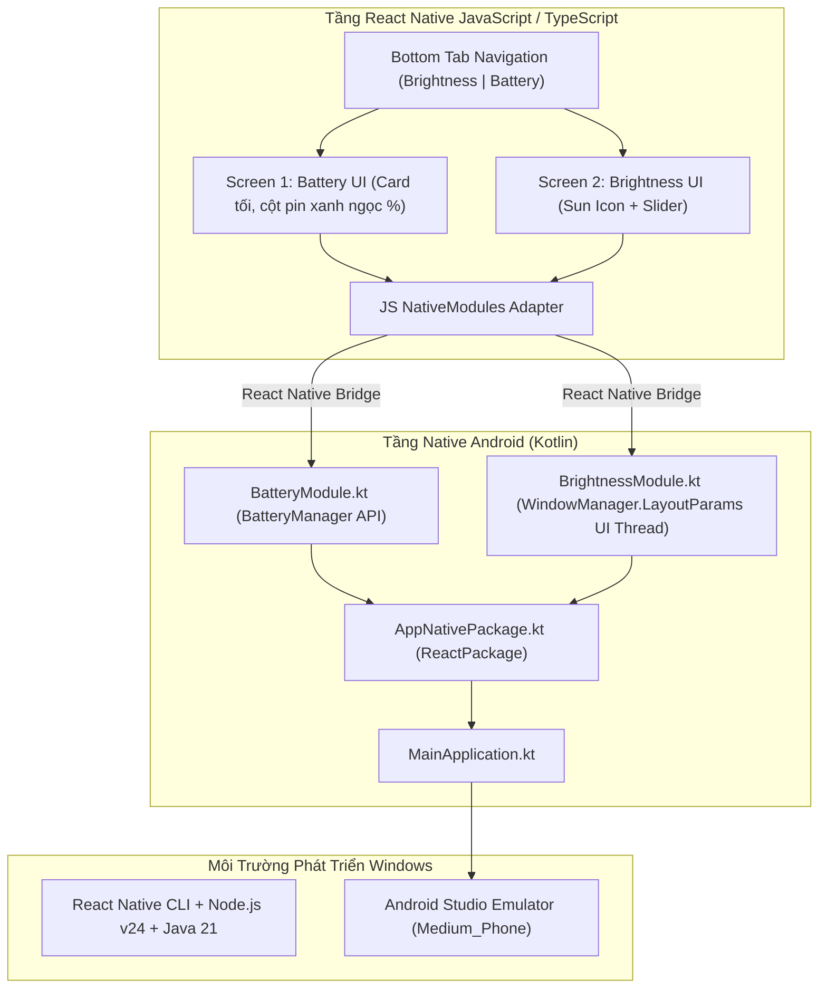
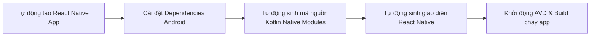

# Kế Hoạch Chi Tiết Triển Khai Lab 2: Native Modules (CSW 434)
**Môn học:** Lập trình Di động Nâng cao (Advanced Mobile Programming - CSW 434)  
**Đơn vị:** Đại học Quốc tế Miền Đông (EIU) - Khoa CNTT  
**Nền tảng mục tiêu:** Android 100% (Không dùng iOS, tương thích hoàn toàn Android Studio Emulator)  
**Máy ảo mục tiêu:** `Medium_Phone` / `Medium_Phone_API_37.0` (Android SDK 34/35/37)  

---

## 1. Phân Tích Phạm Vi & Yêu Cầu Kỹ Thuật (Android Only)



### 1.1. Các nguyên tắc cốt lõi theo tài liệu tham khảo
1. **React Native Docs (Meta Platforms):**
   - Viết các lớp kế thừa `ReactContextBaseJavaModule`.
   - Khai báo `@ReactMethod` cho các hàm JavaScript gọi sang.
   - Sử dụng `com.facebook.react.bridge.Promise` để trả kết quả bất đồng bộ.
   - Đăng ký module thông qua `ReactPackage` và nạp vào `MainApplication.kt`.
2. **Professional React Native (Alexander Benedikt Kuttig - Packt):**
   - **Threading Safety:** `@ReactMethod` chạy trên thread bất đồng bộ của React Native. Việc thay đổi độ sáng màn hình ứng dụng thông qua `window.attributes.screenBrightness` bắt buộc phải chạy trên **Android UI Thread** qua `currentActivity?.runOnUiThread { ... }`.
   - **Performance:** Khi kéo Slider, hàm native được gọi với tần suất cao, do đó phương pháp `WindowManager.LayoutParams` là tối ưu nhất vì xử lý tức thì trong RAM của Activity, không ghi đĩa hay truy vấn ContentProvider.
3. **Android Studio Emulator Compatibility:**
   - **Battery:** Đọc trực tiếp từ `BatteryManager.BATTERY_PROPERTY_CAPACITY`. Máy ảo Android Studio có bảng giả lập pin (Extended Controls) cho phép thay đổi % pin tùy ý để kiểm thử.
   - **Brightness:** Dùng `WindowManager.LayoutParams` cho phép thay đổi độ sáng cửa sổ ứng dụng trực tiếp trên máy ảo mà **không cần quyền hệ thống nguy hiểm `WRITE_SETTINGS`** (tránh triệt để lỗi crash `SecurityException` trên Android 13/14/15 của máy ảo).

---

## 2. Kịch Bản Tự Động Hóa Khởi Tạo Môi Trường (Automated Setup)

Toàn bộ quy trình khởi tạo được script hóa, chỉ tập trung vào Android và loại bỏ hoàn toàn các phần liên quan đến iOS (Podfile, Xcode, CocoaPods).



### 2.1. Bước 1: Khởi tạo Project React Native CLI
Chạy lệnh khởi tạo template chuẩn TypeScript không chứa bloatware iOS:
```powershell
npx @react-native-community/cli@latest init Lab2App --template react-native-template-typescript --skip-install
```

### 2.2. Bước 2: Cài đặt các gói phụ thuộc cần thiết
Di chuyển vào thư mục dự án và cài đặt:
```powershell
cd Lab2App
npm install @react-native-community/slider @react-navigation/native @react-navigation/bottom-tabs react-native-screens react-native-safe-area-context
```

---

## 3. Chi Tiết Triển Khai Mã Nguồn Native Android (Kotlin)

Mã nguồn được đặt trong đường dẫn:  
`android/app/src/main/java/com/lab2app/`

### 3.1. `BatteryModule.kt` (Exercise 1)
- Lấy service `Context.BATTERY_SERVICE`.
- Đọc giá trị `%` qua `BatteryManager.BATTERY_PROPERTY_CAPACITY`.
- Trả về Promise chứa số nguyên (0 - 100).

```kotlin
package com.lab2app

import android.content.Context
import android.os.BatteryManager
import com.facebook.react.bridge.Promise
import com.facebook.react.bridge.ReactApplicationContext
import com.facebook.react.bridge.ReactContextBaseJavaModule
import com.facebook.react.bridge.ReactMethod

class BatteryModule(reactContext: ReactApplicationContext) : ReactContextBaseJavaModule(reactContext) {
    override fun getName(): String = "BatteryModule"

    @ReactMethod
    fun getBatteryLevel(promise: Promise) {
        try {
            val bm = reactApplicationContext.getSystemService(Context.BATTERY_SERVICE) as BatteryManager
            val batLevel = bm.getIntProperty(BatteryManager.BATTERY_PROPERTY_CAPACITY)
            promise.resolve(batLevel)
        } catch (e: Exception) {
            promise.reject("ERR_BATTERY", "Không thể lấy thông tin pin: ${e.message}", e)
        }
    }
}
```

### 3.2. `BrightnessModule.kt` (Exercise 2)
- Nhận giá trị `Float` từ `0.0f` đến `1.0f`.
- Sử dụng `activity.runOnUiThread` để cập nhật `window.attributes.screenBrightness`.
- Cung cấp hàm `getBrightness` để lấy độ sáng hiện tại của ứng dụng.

```kotlin
package com.lab2app

import android.app.Activity
import com.facebook.react.bridge.Promise
import com.facebook.react.bridge.ReactApplicationContext
import com.facebook.react.bridge.ReactContextBaseJavaModule
import com.facebook.react.bridge.ReactMethod

class BrightnessModule(reactContext: ReactApplicationContext) : ReactContextBaseJavaModule(reactContext) {
    override fun getName(): String = "BrightnessModule"

    @ReactMethod
    fun setBrightness(brightness: Double, promise: Promise) {
        val activity: Activity? = reactApplicationContext.currentActivity
        if (activity == null) {
            promise.reject("ERR_ACTIVITY", "Activity không tồn tại")
            return
        }

        activity.runOnUiThread {
            try {
                val layoutParams = activity.window.attributes
                layoutParams.screenBrightness = brightness.toFloat().coerceIn(0.01f, 1.0f)
                activity.window.attributes = layoutParams
                promise.resolve(true)
            } catch (e: Exception) {
                promise.reject("ERR_BRIGHTNESS", "Cannot set brightness: ${e.message}", e)
            }
        }
    }

    @ReactMethod
    fun getBrightness(promise: Promise) {
        val activity: Activity? = reactApplicationContext.currentActivity
        if (activity == null) {
            promise.reject("ERR_ACTIVITY", "Activity không tồn tại")
            return
        }

        activity.runOnUiThread {
            try {
                val current = activity.window.attributes.screenBrightness
                val brightnessVal = if (current < 0) 0.5f else current
                promise.resolve(brightnessVal.toDouble())
            } catch (e: Exception) {
                promise.reject("ERR_BRIGHTNESS", "Cannot get brightness: ${e.message}", e)
            }
        }
    }
}
```

### 3.3. `AppNativePackage.kt`
Đăng ký cả 2 modules vào hệ thống React Native:
```kotlin
package com.lab2app

import android.view.View
import com.facebook.react.ReactPackage
import com.facebook.react.bridge.NativeModule
import com.facebook.react.bridge.ReactApplicationContext
import com.facebook.react.uimanager.ReactShadowNode
import com.facebook.react.uimanager.ViewManager

class AppNativePackage : ReactPackage {
    override fun createNativeModules(reactContext: ReactApplicationContext): List<NativeModule> {
        return listOf(
            BatteryModule(reactContext),
            BrightnessModule(reactContext)
        )
    }

    override fun createViewManagers(reactContext: ReactApplicationContext): List<ViewManager<View, ReactShadowNode<*>>> {
        return emptyList()
    }
}
```

### 3.4. Đăng ký trong `MainApplication.kt`
Thêm `AppNativePackage()` vào danh sách `PackageList(this).packages.apply { add(AppNativePackage()) }`.

---

## 4. Chi Tiết Giao Diện React Native (Bám Sát 100% Ảnh Đề Bài)

### 4.1. Cấu trúc thư mục mã nguồn
```
Lab2App/
├── android/                  # Mã nguồn gốc Android Kotlin
├── src/
│   ├── native/
│   │   ├── BatteryModule.ts  # Typed Wrapper cho Battery Native Module
│   │   └── BrightnessModule.ts # Typed Wrapper cho Brightness Native Module
│   ├── screens/
│   │   ├── BatteryScreen.tsx # Screen 1: Giao diện Pin dark card & chất lỏng %
│   │   └── BrightnessScreen.tsx # Screen 2: Mặt trời tia nắng & Slider
│   └── navigation/
│       └── BottomTabs.tsx    # Bottom Navigation chuẩn hình mẫu
└── App.tsx                   # Root component
```

### 4.2. Giao diện Screen 1 (Battery Screen)
- **Thiết kế:** Card nền xanh than đậm bo góc (rounded card) nổi trên nền trắng.
- **Biểu tượng pin:** 
  - Khung viền mờ với cực dương nhô ra phía trên phát sáng nhẹ.
  - Phần chất lỏng hiển thị màu xanh ngọc tươi (cyan gradient `#00E5FF` $\rightarrow$ `#00E676`) nâng hạ theo đúng số `%` lấy từ `BatteryModule.getBatteryLevel()`.
  - Hiển thị số to đậm `"80"` và ký tự `"%"` rõ nét ở trung tâm.
  - Tự động cập nhật mỗi khi người dùng mở tab hoặc bấm làm mới.

### 4.3. Giao diện Screen 2 (Brightness Screen)
- **Thẻ 1 (Biểu tượng mặt trời %):**
  - Vòng tròn trung tâm có 8 vạch tia nắng hướng tâm.
  - Hiển thị số phần trăm `"0%"` hoặc `"X%"` ở giữa.
- **Thẻ 2 (Điều khiển Brightness):**
  - Chữ "Brightness" phía trên.
  - Icon mặt trời nhỏ phía trước.
  - Thanh trượt Slider (`@react-native-community/slider`) với thumb tròn màu xanh dương (`#007AFF`), track bên trái màu xanh và bên phải màu xám nhạt/hồng pastel.
  - Sự kiện `onValueChange` gọi thẳng `BrightnessModule.setBrightness(val)` để màn hình máy ảo thay đổi ngay lập tức.

---

## 5. Hướng Dẫn Kiểm Thử Trực Tiếp Trên Máy Ảo Android Studio

### 5.1. Khởi động máy ảo từ dòng lệnh hoặc Android Studio
Có thể bật máy ảo trực tiếp qua lệnh:
```powershell
& "C:\Users\dangt\AppData\Local\Android\Sdk\emulator\emulator.exe" -avd Medium_Phone
```
Kiểm tra kết nối:
```powershell
adb devices
```

### 5.2. Biên dịch và khởi chạy ứng dụng
```powershell
cd Lab2App
npm run android
```

### 5.3. Các kịch bản kiểm thử (Test Cases)
1. **Kiểm thử Battery (Screen 1):**
   - Trên thanh công cụ của máy ảo Android Emulator, bấm vào nút **`...` (Extended Controls)**.
   - Chọn menu **Battery** ở cột trái.
   - Kéo thanh trượt **Charge level** sang 20%, 50%, 80%, 100%.
   - Chuyển tab hoặc chạm màn hình để xem mức pin trên Screen 1 thay đổi tức thì.
2. **Kiểm thử Brightness (Screen 2):**
   - Kéo thanh slider trên Screen 2 từ 0% đến 100%.
   - Quan sát cửa sổ ứng dụng trên máy ảo tự động tối dần về mức tối thiểu hoặc sáng bừng lên tối đa.
   - Số % trong vòng tròn mặt trời hiển thị chính xác tương ứng.
